# Kingmaker — Rivers Run Red: Kingdom Reference Pages 55–65

> Extracted from printed pages 55–65, corresponding to PDF pages 57–67. The original PDF remains untouched. Page images are preserved because some charts and city-layout graphics do not survive text extraction cleanly.

- Source: `E:\VirtualShare\Vault2.0.-.TTRPG-Gamebooks\Pathfinder\1st Edition\Adventure Paths\PF031-036 - KingMaker\Kingmaker - 02 - Rivers Run Red.pdf`
- PDF page range: 57–67
- Printed page range: 55–65
- Extracted on: 2026-10-16


## Printed page 55 (PDF page 57)

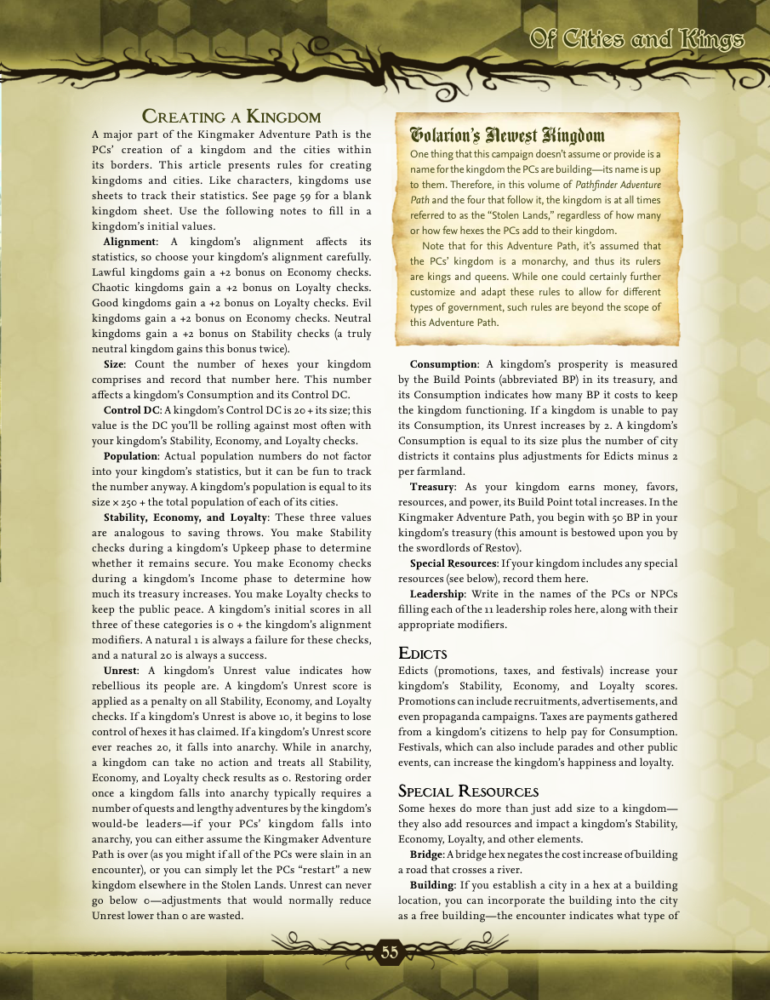


```text
55
Of Cities and KingsOf Cities and Kings
C
r e a t i n g

a
 K
i n g d o m
A major part of the Kingmaker Adventure Path is the
PCs’ creation of a kingdom and the cities within
its borders. This article presents rules for creating
kingdoms and cities. Like characters, kingdoms use
sheets to track their statistics. See page 59 for a blank
kingdom sheet. Use the following notes to fill in a
kingdom’s initial values.
Alignment : A kingdom’s alignment affects its
statistics, so choose your kingdom’s alignment carefully.
Lawful kingdoms gain a +2 bonus on Economy checks.
Chaotic kingdoms gain a +2 bonus on Loyalty checks.
Good kingdoms gain a +2 bonus on Loyalty checks. Evil
kingdoms gain a +2 bonus on Economy checks. Neutral
kingdoms gain a +2 bonus on Stability checks (a truly
neutral kingdom gains this bonus twice).
Size: Count the number of hexes your kingdom
comprises and record that number here. This number
affects a kingdom’s Consumption and its Control DC.
Control DC: A kingdom’s Control DC is 20 + its size; this
value is the DC you’ll be rolling against most often with
your kingdom’s Stability, Economy, and Loyalty checks.
Population : Actual population numbers do not factor
into your kingdom’s statistics, but it can be fun to track
the number anyway. A kingdom’s population is equal to its
size × 250 + the total population of each of its cities.
Stability, Economy, and Loyalty : These three values
are analogous to saving throws. You make Stability
checks during a kingdom’s Upkeep phase to determine
whether it remains secure. You make Economy checks
during a kingdom’s Income phase to determine how
much its treasury increases. You make Loyalty checks to
keep the public peace. A kingdom’s initial scores in all
three of these categories is 0 + the kingdom’s alignment
modifiers. A natural 1 is always a failure for these checks,
and a natural 20 is always a success.
Unrest: A kingdom’s Unrest value indicates how
rebellious its people are. A kingdom’s Unrest score is
applied as a penalty on all Stability, Economy, and Loyalty
checks. If a kingdom’s Unrest is above 10, it begins to lose
control of hexes it has claimed. If a kingdom’s Unrest score
ever reaches 20, it falls into anarchy. While in anarchy,
a kingdom can take no action and treats all Stability,
Economy, and Loyalty check results as 0. Restoring order
once a kingdom falls into anarchy typically requires a
number of quests and lengthy adventures by the kingdom’s
would-be leaders—if your PCs’ kingdom falls into
anarchy, you can either assume the Kingmaker Adventure
Path is over (as you might if all of the PCs were slain in an
encounter), or you can simply let the PCs “restart” a new
kingdom elsewhere in the Stolen Lands. Unrest can never
go below 0—adjustments that would normally reduce
Unrest lower than 0 are wasted.
Golarion’s Newest Kingdom
One thing that this campaign doesn’t assume or provide is a
name for the kingdom the PCs are building—its name is up
to them. Therefore, in this volume of Pathfinder Adventure
Path and the four that follow it, the kingdom is at all times
referred to as the “Stolen Lands,” regardless of how many
or how few hexes the PCs add to their kingdom.
Note that for this Adventure Path, it’s assumed that
the PCs’ kingdom is a monarchy, and thus its rulers
are kings and queens. While one could certainly further
customize and adapt these rules to allow for different
types of government, such rules are beyond the scope of
this Adventure Path.
Consumption : A kingdom’s prosperity is measured
by the Build Points (abbreviated BP) in its treasury, and
its Consumption indicates how many BP it costs to keep
the kingdom functioning. If a kingdom is unable to pay
its Consumption, its Unrest increases by 2. A kingdom’s
Consumption is equal to its size plus the number of city
districts it contains plus adjustments for Edicts minus 2
per farmland.
Treasury : As your kingdom earns money, favors,
resources, and power, its Build Point total increases. In the
Kingmaker Adventure Path, you begin with 50 BP in your
kingdom’s treasury (this amount is bestowed upon you by
the swordlords of Restov).
Special Resources : If your kingdom includes any special
resources (see below), record them here.
Leadership : Write in the names of the PCs or NPCs
filling each of the 11 leadership roles here, along with their
appropriate modifiers.
e
d iCt s
Edicts (promotions, taxes, and festivals) increase your
kingdom’s Stability, Economy, and Loyalty scores.
Promotions can include recruitments, advertisements, and
even propaganda campaigns. Taxes are payments gathered
from a kingdom’s citizens to help pay for Consumption.
Festivals, which can also include parades and other public
events, can increase the kingdom’s happiness and loyalty.
s
p eCi a l
 r
e s o u rCe s
Some hexes do more than just add size to a kingdom—
they also add resources and impact a kingdom’s Stability,
Economy, Loyalty, and other elements.
Bridge: A bridge hex negates the cost increase of building
a road that crosses a river.
Building : If you establish a city in a hex at a building
location, you can incorporate the building into the city
as a free building—the encounter indicates what type of
```


## Printed page 56 (PDF page 58)

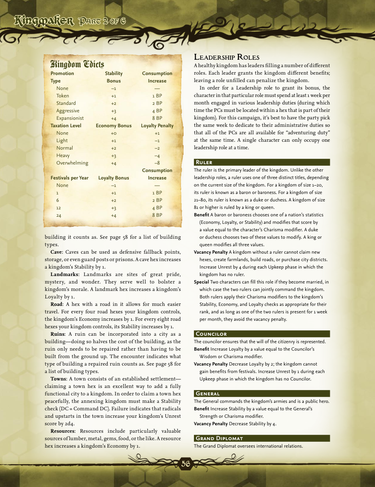


```text
56
P
a r t
 2
o f
 6P
a r t
 2
o f
 6
building it counts as. See page 58 for a list of building
types.
Cave: Caves can be used as defensive fallback points,
storage, or even guard posts or prisons. A cave hex increases
a kingdom’s Stability by 1.
Landmarks : Landmarks are sites of great pride,
mystery, and wonder. They serve well to bolster a
kingdom’s morale. A landmark hex increases a kingdom’s
Loyalty by 1.
Road: A hex with a road in it allows for much easier
travel. For every four road hexes your kingdom controls,
the kingdom’s Economy increases by 1. For every eight road
hexes your kingdom controls, its Stability increases by 1.
Ruins: A ruin can be incorporated into a city as a
building—doing so halves the cost of the building, as the
ruin only needs to be repaired rather than having to be
built from the ground up. The encounter indicates what
type of building a repaired ruin counts as. See page 58 for
a list of building types.
Towns: A town consists of an established settlement—
claiming a town hex is an excellent way to add a fully
functional city to a kingdom. In order to claim a town hex
peacefully, the annexing kingdom must make a Stability
check (DC = Command DC). Failure indicates that radicals
and upstarts in the town increase your kingdom’s Unrest
score by 2d4.
Resources : Resources include particularly valuable
sources of lumber, metal, gems, food, or the like. A resource
hex increases a kingdom’s Economy by 1.
l
e a d e r s h i p
 r
o l e s
A healthy kingdom has leaders filling a number of different
roles. Each leader grants the kingdom different benefits;
leaving a role unfilled can penalize the kingdom.
In order for a Leadership role to grant its bonus, the
character in that particular role must spend at least 1 week per
month engaged in various leadership duties (during which
time the PCs must be located within a hex that is part of their
kingdom). For this campaign, it’s best to have the party pick
the same week to dedicate to their administrative duties so
that all of the PCs are all available for “adventuring duty”
at the same time. A single character can only occupy one
leadership role at a time.
Ruler
The ruler is the primary leader of the kingdom. Unlike the other
leadership roles, a ruler uses one of three distinct titles, depending
on the current size of the kingdom. For a kingdom of size 1–20,
its ruler is known as a baron or baroness. For a kingdom of size
21–80, its ruler is known as a duke or duchess. A kingdom of size
81 or higher is ruled by a king or queen.
Benefit A baron or baroness chooses one of a nation’s statistics
(Economy, Loyalty, or Stability) and modifies that score by
a value equal to the character’s Charisma modifier. A duke
or duchess chooses two of these values to modify. A king or
queen modifies all three values.
Vacancy Penalty  A kingdom without a ruler cannot claim new
hexes, create farmlands, build roads, or purchase city districts.
Increase Unrest by 4 during each Upkeep phase in which the
kingdom has no ruler.
Special Two characters can fill this role if they become married, in
which case the two rulers can jointly command the kingdom.
Both rulers apply their Charisma modifiers to the kingdom’s
Stability, Economy, and Loyalty checks as appropriate for their
rank, and as long as one of the two rulers is present for 1 week
per month, they avoid the vacancy penalty.
Councilor
The councilor ensures that the will of the citizenry is represented.
Benefit Increase Loyalty by a value equal to the Councilor’s
Wisdom or Charisma modifier.
Vacancy Penalty  Decrease Loyalty by 2; the kingdom cannot
gain benefits from festivals. Increase Unrest by 1 during each
Upkeep phase in which the kingdom has no Councilor.
General
The General commands the kingdom’s armies and is a public hero.
Benefit Increase Stability by a value equal to the General’s
Strength or Charisma modifier.
Vacancy Penalty  Decrease Stability by 4.
Grand Diplomat
The Grand Diplomat oversees international relations.
Kingdom Edicts
Promotion Stability Consumption
Type Bonus Increase
None –1 —
Token +1 1 BP
Standard +2 2 BP
Aggressive +3 4 BP
Expansionist +4 8 BP
Taxation Level Economy Bonus Loyalty Penalty
None +0 +1
Light +1 –1
Normal +2 –2
Heavy +3 –4
Overwhelming +4 –8
  Consumption
Festivals per Year Loyalty Bonus Increase
None –1 —
1 +1 1 BP
6 +2 2 BP
12 +3 4 BP
24 +4 8 BP
```


## Printed page 57 (PDF page 59)

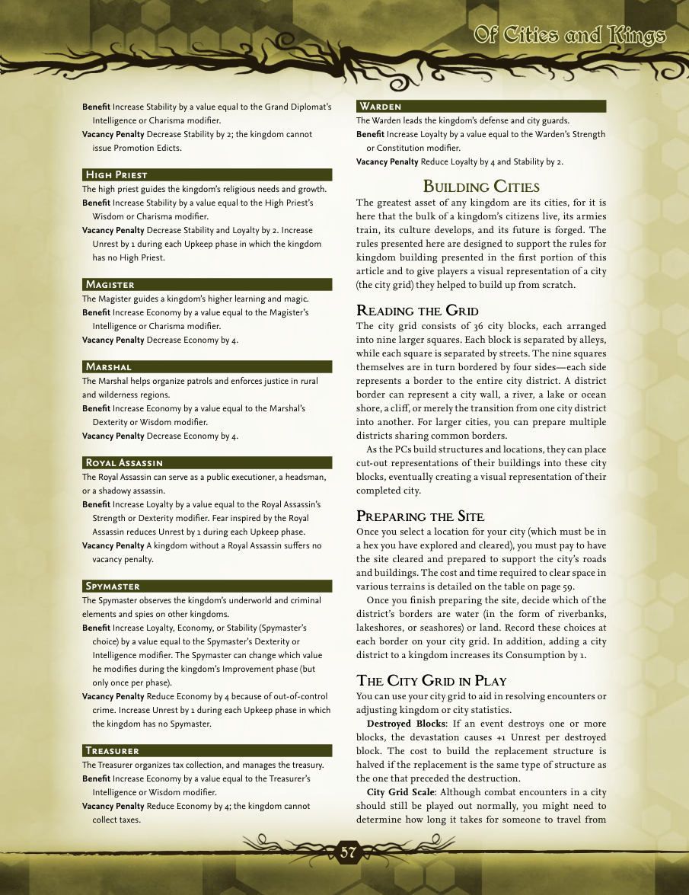


```text
57
Of Cities and KingsOf Cities and Kings
Benefit Increase Stability by a value equal to the Grand Diplomat’s
Intelligence or Charisma modifier.
Vacancy Penalty  Decrease Stability by 2; the kingdom cannot
issue Promotion Edicts.
High Priest
The high priest guides the kingdom’s religious needs and growth.
Benefit Increase Stability by a value equal to the High Priest’s
Wisdom or Charisma modifier.
Vacancy Penalty  Decrease Stability and Loyalty by 2. Increase
Unrest by 1 during each Upkeep phase in which the kingdom
has no High Priest.
Magister
The Magister guides a kingdom’s higher learning and magic.
Benefit Increase Economy by a value equal to the Magister’s
Intelligence or Charisma modifier.
Vacancy Penalty  Decrease Economy by 4.
Marshal
The Marshal helps organize patrols and enforces justice in rural
and wilderness regions.
Benefit Increase Economy by a value equal to the Marshal’s
Dexterity or Wisdom modifier.
Vacancy Penalty  Decrease Economy by 4.
Royal Assassin
The Royal Assassin can serve as a public executioner, a headsman,
or a shadowy assassin.
Benefit Increase Loyalty by a value equal to the Royal Assassin’s
Strength or Dexterity modifier. Fear inspired by the Royal
Assassin reduces Unrest by 1 during each Upkeep phase.
Vacancy Penalty  A kingdom without a Royal Assassin suffers no
vacancy penalty.
Spymaster
The Spymaster observes the kingdom’s underworld and criminal
elements and spies on other kingdoms.
Benefit Increase Loyalty, Economy, or Stability (Spymaster’s
choice) by a value equal to the Spymaster’s Dexterity or
Intelligence modifier. The Spymaster can change which value
he modifies during the kingdom’s Improvement phase (but
only once per phase).
Vacancy Penalty  Reduce Economy by 4 because of out-of-control
crime. Increase Unrest by 1 during each Upkeep phase in which
the kingdom has no Spymaster.
Treasurer
The Treasurer organizes tax collection, and manages the treasury.
Benefit Increase Economy by a value equal to the Treasurer’s
Intelligence or Wisdom modifier.
Vacancy Penalty  Reduce Economy by 4; the kingdom cannot
collect taxes.
Warden
The Warden leads the kingdom’s defense and city guards.
Benefit Increase Loyalty by a value equal to the Warden’s Strength
or Constitution modifier.
Vacancy Penalty  Reduce Loyalty by 4 and Stability by 2.
B
u i l d i n g
 C
i t i e s
The greatest asset of any kingdom are its cities, for it is
here that the bulk of a kingdom’s citizens live, its armies
train, its culture develops, and its future is forged. The
rules presented here are designed to support the rules for
kingdom building presented in the first portion of this
article and to give players a visual representation of a city
(the city grid) they helped to build up from scratch.
r
e a d i n g

t h e
 g
r i d
The city grid consists of 36 city blocks, each arranged
into nine larger squares. Each block is separated by alleys,
while each square is separated by streets. The nine squares
themselves are in turn bordered by four sides—each side
represents a border to the entire city district. A district
border can represent a city wall, a river, a lake or ocean
shore, a cliff, or merely the transition from one city district
into another. For larger cities, you can prepare multiple
districts sharing common borders.
As the PCs build structures and locations, they can place
cut-out representations of their buildings into these city
blocks, eventually creating a visual representation of their
completed city.
p
r e p a r i n g

t h e
 s
i t e
Once you select a location for your city (which must be in
a hex you have explored and cleared), you must pay to have
the site cleared and prepared to support the city’s roads
and buildings. The cost and time required to clear space in
various terrains is detailed on the table on page 59.
Once you finish preparing the site, decide which of the
district’s borders are water (in the form of riverbanks,
lakeshores, or seashores) or land. Record these choices at
each border on your city grid. In addition, adding a city
district to a kingdom increases its Consumption by 1.
t
h e
 C
i t y
 g
r i d

i n
 p
l a y
You can use your city grid to aid in resolving encounters or
adjusting kingdom or city statistics.
Destroyed Blocks : If an event destroys one or more
blocks, the devastation causes +1 Unrest per destroyed
block. The cost to build the replacement structure is
halved if the replacement is the same type of structure as
the one that preceded the destruction.
City Grid Scale : Although combat encounters in a city
should still be played out normally, you might need to
determine how long it takes for someone to travel from
```


## Printed page 58 (PDF page 60)

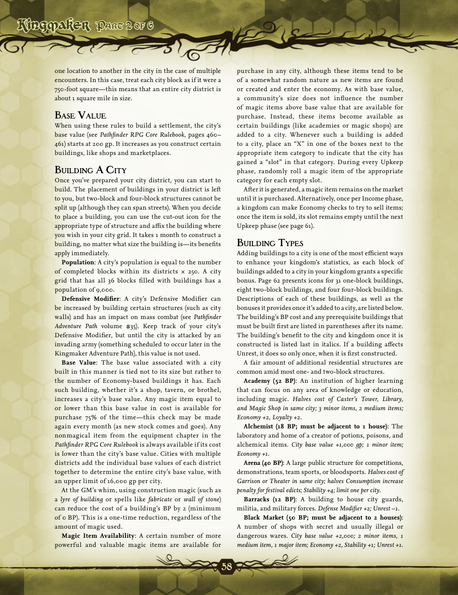


```text
58
P
a r t
 2
o f
 6P
a r t
 2
o f
 6
one location to another in the city in the case of multiple
encounters. In this case, treat each city block as if it were a
750-foot square—this means that an entire city district is
about 1 square mile in size.
B
a s e
 V
a l u e
When using these rules to build a settlement, the city’s
base value (see Pathfinder RPG Core Rulebook , pages 460–
461) starts at 200 gp. It increases as you construct certain
buildings, like shops and marketplaces.
B
u i l d i n g
 a C
i t y
Once you’ve prepared your city district, you can start to
build. The placement of buildings in your district is left
to you, but two-block and four-block structures cannot be
split up (although they can span streets). When you decide
to place a building, you can use the cut-out icon for the
appropriate type of structure and affix the building where
you wish in your city grid. It takes 1 month to construct a
building, no matter what size the building is—its benefits
apply immediately.
Population : A city’s population is equal to the number
of completed blocks within its districts × 250. A city
grid that has all 36 blocks filled with buildings has a
population of 9,000.
Defensive Modifier : A city’s Defensive Modifier can
be increased by building certain structures (such as city
walls) and has an impact on mass combat (see Pathfinder
Adventure Path  volume #35). Keep track of your city’s
Defensive Modifier, but until the city is attacked by an
invading army (something scheduled to occur later in the
Kingmaker Adventure Path), this value is not used.
Base Value : The base value associated with a city
built in this manner is tied not to its size but rather to
the number of Economy-based buildings it has. Each
such building, whether it’s a shop, tavern, or brothel,
increases a city’s base value. Any magic item equal to
or lower than this base value in cost is available for
purchase 75% of the time—this check may be made
again every month (as new stock comes and goes). Any
nonmagical item from the equipment chapter in the
Pathfinder RPG Core Rulebook  is always available if its cost
is lower than the city’s base value. Cities with multiple
districts add the individual base values of each district
together to determine the entire city’s base value, with
an upper limit of 16,000 gp per city.
At the GM’s whim, using construction magic (such as
a lyre of building  or spells like fabricate  or wall of stone )
can reduce the cost of a building’s BP by 2 (minimum
of 0 BP). This is a one-time reduction, regardless of the
amount of magic used.
Magic Item Availability : A certain number of more
powerful and valuable magic items are available for
purchase in any city, although these items tend to be
of a somewhat random nature as new items are found
or created and enter the economy. As with base value,
a community’s size does not influence the number
of magic items above base value that are available for
purchase. Instead, these items become available as
certain buildings (like academies or magic shops) are
added to a city. Whenever such a building is added
to a city, place an “X” in one of the boxes next to the
appropriate item category to indicate that the city has
gained a “slot” in that category. During every Upkeep
phase, randomly roll a magic item of the appropriate
category for each empty slot.
After it is generated, a magic item remains on the market
until it is purchased. Alternatively, once per Income phase,
a kingdom can make Economy checks to try to sell items;
once the item is sold, its slot remains empty until the next
Upkeep phase (see page 61).
B
u i l d i n g
 t
y p e s
Adding buildings to a city is one of the most efficient ways
to enhance your kingdom’s statistics, as each block of
buildings added to a city in your kingdom grants a specific
bonus. Page 62 presents icons for 31 one-block buildings,
eight two-block buildings, and four four-block buildings.
Descriptions of each of these buildings, as well as the
bonuses it provides once it’s added to a city, are listed below.
The building’s BP cost and any prerequisite buildings that
must be built first are listed in parentheses after its name.
The building’s benefit to the city and kingdom once it is
constructed is listed last in italics. If a building affects
Unrest, it does so only once, when it is first constructed.
A fair amount of additional residential structures are
common amid most one- and two-block structures.
Academy (52 BP) : An institution of higher learning
that can focus on any area of knowledge or education,
including magic. Halves cost of Caster’s Tower, Library,
and Magic Shop in same city; 3 minor items, 2 medium items;
Economy +2, Loyalty +2.
Alchemist (18 BP; must be adjacent to 1 house) : The
laboratory and home of a creator of potions, poisons, and
alchemical items. City base value +1,000 gp; 1 minor item;
Economy +1.
Arena (40 BP) : A large public structure for competitions,
demonstrations, team sports, or bloodsports. Halves cost of
Garrison or Theater in same city; halves Consumption increase
penalty for festival edicts; Stability +4; limit one per city.
Barracks (12 BP) : A building to house city guards,
militia, and military forces. Defense Modifier +2; Unrest –1.
Black Market (50 BP; must be adjacent to 2 houses) :
A number of shops with secret and usually illegal or
dangerous wares. City base value +2,000; 2 minor items, 1
medium item, 1 major item;  Economy +2, Stability +1; Unrest +1.
```


## Printed page 59 (PDF page 61)

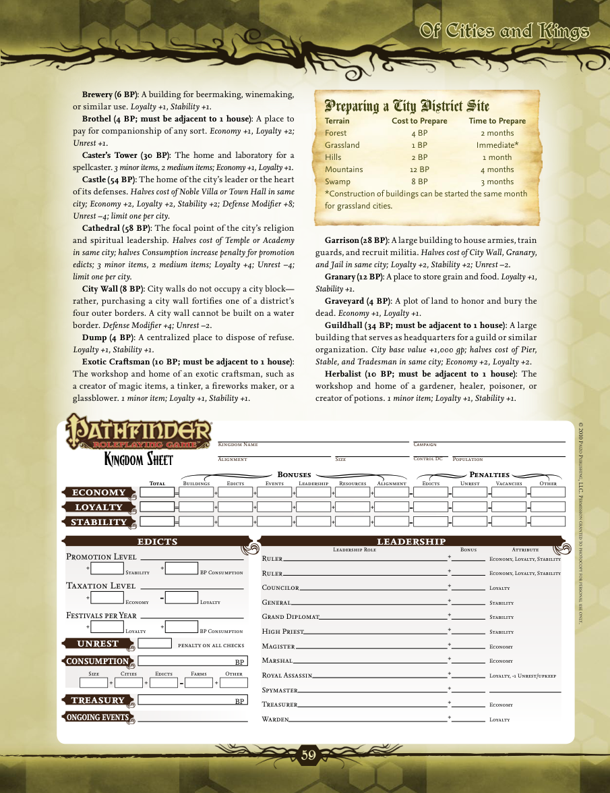


```text
59
Of Cities and KingsOf Cities and Kings
© 2010 P
a i z o
 P
u b l i s h i n g
, llC. P
e r m i s s i o n

g r a n t e d

t o

Ph o t oCoPy

f o r

Pe r s o n a l

u s e

o n l y
.
g
g
s
s
s
s
Kingdom Name
Alignment Size Population
Campaign
=
=
=
+ + + + +
-- - -
-
-
-
- -
- - -
+ + + + +
+ + + + +
economy
edicts
Bonuses
K
i n g d o m
 S
h e e t
Penalties
leadership
loyalty
stability
BuildingsTotal Edicts Events Leadership Resources Alignment VacanciesUnrestEdicts Other
+
+
+
+
+
+
+
+
+
+
+
+
Leadership Role Bonus Attribute
Ruler
Ruler
Councilor
General
Grand Diplomat
High Priest
Magister
Marshal
Royal Assassin
Spymaster
Treasurer
Warden
Economy, Loyalty, Stability
Economy, Loyalty, Stability
Loyalty
Stability
Stability
Stability
Economy
Economy
Loyalty, -1 Unrest/upkeep
Economy
Loyalty
g
ongoing events
+
+
+ +
+
-
Promotion Level
Taxation Level
Festivals per Year

Economy

Loyalty  BP Consumption

BP Consumption

Loyalty

Stability
g
unrest

penalty on all checks
g
+ + +
-
Size Cities Edicts Farms Other
consumption
BP
gg
treasury
BP
g
g
™
®
Control DC
Brewery (6 BP): A building for beermaking, winemaking,
or similar use. Loyalty +1,  Stability +1.
Brothel (4 BP; must be adjacent to 1 house) : A place to
pay for companionship of any sort. Economy +1,  Loyalty +2;
Unrest +1.
Caster’s Tower (30 BP) : The home and laboratory for a
spellcaster. 3 minor items, 2 medium items; Economy +1, Loyalty +1.
Castle (54 BP) : The home of the city’s leader or the heart
of its defenses. Halves cost of Noble Villa or Town Hall in same
city; Economy +2, Loyalty +2, Stability +2; Defense Modifier +8;
Unrest –4; limit one per city.
Cathedral (58 BP) : The focal point of the city’s religion
and spiritual leadership. Halves cost of Temple or Academy
in same city; halves Consumption increase penalty for promotion
edicts; 3 minor items, 2 medium items; Loyalty +4; Unrest –4;
limit one per city.
City Wall (8 BP) : City walls do not occupy a city block—
rather, purchasing a city wall fortifies one of a district’s
four outer borders. A city wall cannot be built on a water
border. Defense Modifier +4; Unrest –2 .
Dump (4 BP) : A centralized place to dispose of refuse.
Loyalty +1, Stability +1.
Exotic Craftsman (10 BP; must be adjacent to 1 house) :
The workshop and home of an exotic craftsman, such as
a creator of magic items, a tinker, a fireworks maker, or a
glassblower. 1 minor item; Loyalty +1, Stability +1 .
Preparing a City District Site
Terrain Cost to Prepare Time to Prepare
Forest 4 BP 2 months
Grassland 1 BP Immediate*
Hills 2 BP 1 month
Mountains 12 BP 4 months
Swamp 8 BP 3 months
*Construction of buildings can be started the same month
for grassland cities.
Garrison (28 BP) : A large building to house armies, train
guards, and recruit militia. Halves cost of City Wall, Granary,
and Jail in same city; Loyalty +2, Stability +2; Unrest –2.
Granary (12 BP): A place to store grain and food. Loyalty +1,
Stability +1.
Graveyard (4 BP) : A plot of land to honor and bury the
dead. Economy +1, Loyalty +1.
Guildhall (34 BP; must be adjacent to 1 house) : A large
building that serves as headquarters for a guild or similar
organization. City base value +1,000 gp; halves cost of Pier,
Stable, and Tradesman in same city; Economy +2, Loyalty +2.
Herbalist (10 BP; must be adjacent to 1 house) : The
workshop and home of a gardener, healer, poisoner, or
creator of potions. 1 minor item; Loyalty +1, Stability +1.
```


## Printed page 60 (PDF page 62)

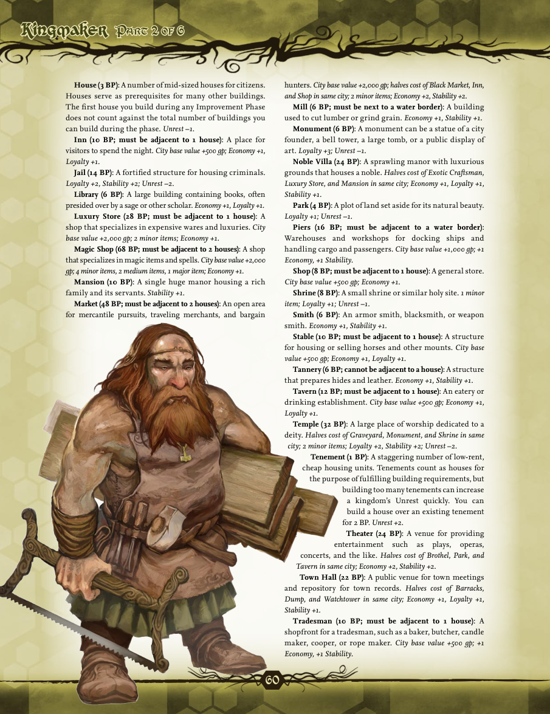


```text
60
P
a r t
 2
o f
 6P
a r t
 2
o f
 6
House (3 BP): A number of mid-sized houses for citizens.
Houses serve as prerequisites for many other buildings.
The first house you build during any Improvement Phase
does not count against the total number of buildings you
can build during the phase. Unrest –1.
Inn (10 BP; must be adjacent to 1 house) : A place for
visitors to spend the night. City base value +500 gp; Economy +1,
Loyalty +1.
Jail (14 BP) : A fortified structure for housing criminals.
Loyalty +2, Stability +2; Unrest –2 .
Library (6 BP) : A large building containing books, often
presided over by a sage or other scholar. Economy +1, Loyalty +1.
Luxury Store  (28 BP; must be adjacent to 1 house) : A
shop that specializes in expensive wares and luxuries. City
base value +2,000 gp; 2 minor items; Economy +1.
Magic Shop (68 BP; must be adjacent to 2 houses): A shop
that specializes in magic items and spells. City base value +2,000
gp; 4 minor items, 2 medium items, 1 major item; Economy +1.
Mansion (10 BP) : A single huge manor housing a rich
family and its servants. Stability +1.
Market (48 BP; must be adjacent to 2 houses): An open area
for mercantile pursuits, traveling merchants, and bargain
hunters. City base value +2,000 gp; halves cost of Black Market, Inn,
and Shop in same city; 2 minor items; Economy +2, Stability +2.
Mill (6 BP; must be next to a water border) : A building
used to cut lumber or grind grain. Economy +1, Stability +1.
Monument (6 BP) : A monument can be a statue of a city
founder, a bell tower, a large tomb, or a public display of
art. Loyalty +3; Unrest –1.
Noble Villa (24 BP) : A sprawling manor with luxurious
grounds that houses a noble. Halves cost of Exotic Craftsman,
Luxury Store, and Mansion in same city; Economy +1, Loyalty +1,
Stability +1.
Park (4 BP): A plot of land set aside for its natural beauty.
Loyalty +1; Unrest –1.
Piers (16 BP; must be adjacent to a water border) :
Warehouses and workshops for docking ships and
handling cargo and passengers. City base value +1,000 gp; +1
Economy, +1 Stability.
Shop (8 BP; must be adjacent to 1 house): A general store.
City base value +500 gp; Economy +1.
Shrine (8 BP) : A small shrine or similar holy site. 1 minor
item; Loyalty +1; Unrest –1.
Smith (6 BP) : An armor smith, blacksmith, or weapon
smith. Economy +1, Stability +1.
Stable (10 BP; must be adjacent to 1 house) : A structure
for housing or selling horses and other mounts. City base
value +500 gp; Economy +1, Loyalty +1.
Tannery (6 BP; cannot be adjacent to a house): A structure
that prepares hides and leather. Economy +1, Stability +1.
Tavern (12 BP; must be adjacent to 1 house): An eatery or
drinking establishment.  City base value +500 gp; Economy +1,
Loyalty +1.
Temple (32 BP) : A large place of worship dedicated to a
deity. Halves cost of Graveyard, Monument, and Shrine in same
city; 2 minor items; Loyalty +2, Stability +2; Unrest –2.
Tenement (1 BP): A staggering number of low-rent,
cheap housing units. Tenements count as houses for
the purpose of fulfilling building requirements, but
building too many tenements can increase
a kingdom’s Unrest quickly. You can
build a house over an existing tenement
for 2 BP. Unrest +2.
Theater (24 BP) : A venue for providing
entertainment such as plays, operas,
concerts, and the like. Halves cost of Brothel, Park, and
Tavern in same city; Economy +2, Stability +2.
Town Hall (22 BP) : A public venue for town meetings
and repository for town records.  H a l v e s  c o s t  o f  B a r r a c k s ,
Dump, and Watchtower in same city; Economy +1, Loyalty +1,
Stability +1.
Tradesman (10 BP; must be adjacent to 1 house) : A
shopfront for a tradesman, such as a baker, butcher, candle
maker, cooper, or rope maker.  City base value +500 gp; +1
Economy, +1 Stability.
```


## Printed page 61 (PDF page 63)

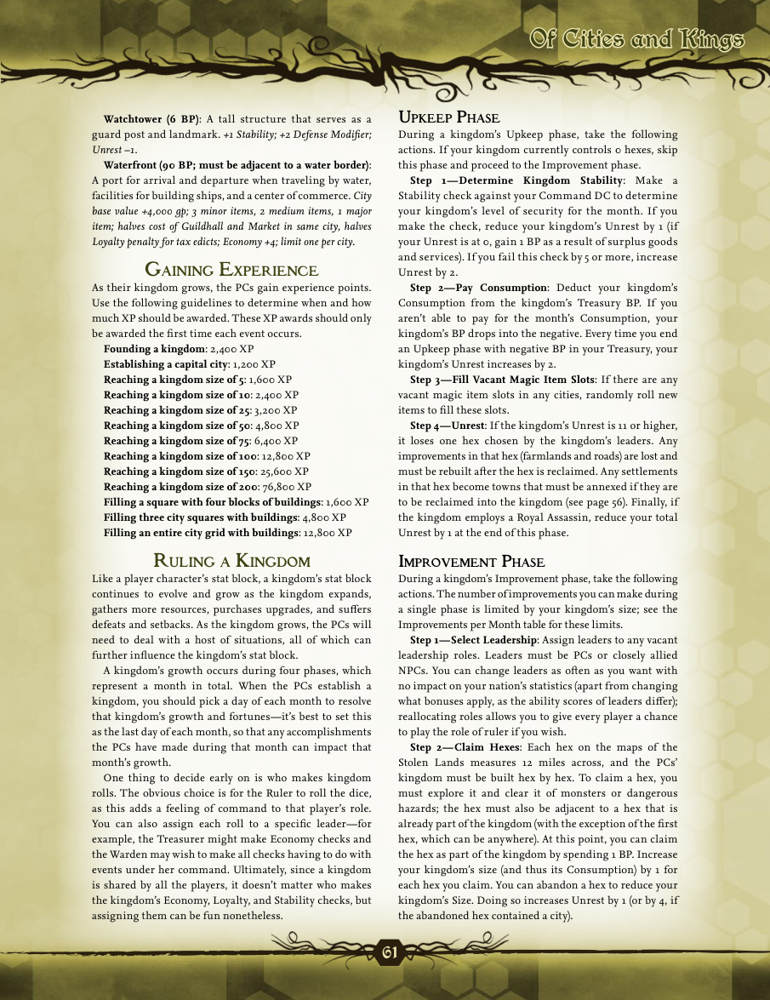


```text
61
Of Cities and KingsOf Cities and Kings
Watchtower (6 BP) : A tall structure that serves as a
guard post and landmark.  +1 Stability; +2 Defense Modifier;
Unrest –1.
Waterfront (90 BP; must be adjacent to a water border) :
A port for arrival and departure when traveling by water,
facilities for building ships, and a center of commerce.  City
base value +4,000 gp; 3 minor items, 2 medium items, 1 major
item; halves cost of Guildhall and Market in same city, halves
Loyalty penalty for tax edicts; Economy +4; limit one per city.
g
a i n i n g
 e
x p e r i e nCe
As their kingdom grows, the PCs gain experience points.
Use the following guidelines to determine when and how
much XP should be awarded. These XP awards should only
be awarded the first time each event occurs.
Founding a kingdom : 2,400 XP
Establishing a capital city : 1,200 XP
Reaching a kingdom size of 5 : 1,600 XP
Reaching a kingdom size of 10 : 2,400 XP
Reaching a kingdom size of 25 : 3,200 XP
Reaching a kingdom size of 50 : 4,800 XP
Reaching a kingdom size of 75 : 6,400 XP
Reaching a kingdom size of 100 : 12,800 XP
Reaching a kingdom size of 150 : 25,600 XP
Reaching a kingdom size of 200 : 76,800 XP
Filling a square with four blocks of buildings : 1,600 XP
Filling three city squares with buildings : 4,800 XP
Filling an entire city grid with buildings : 12,800 XP
r
u l i n g

a
 K
i n g d o m
Like a player character’s stat block, a kingdom’s stat block
continues to evolve and grow as the kingdom expands,
gathers more resources, purchases upgrades, and suffers
defeats and setbacks. As the kingdom grows, the PCs will
need to deal with a host of situations, all of which can
further influence the kingdom’s stat block.
A kingdom’s growth occurs during four phases, which
represent a month in total. When the PCs establish a
kingdom, you should pick a day of each month to resolve
that kingdom’s growth and fortunes—it’s best to set this
as the last day of each month, so that any accomplishments
the PCs have made during that month can impact that
month’s growth.
One thing to decide early on is who makes kingdom
rolls. The obvious choice is for the Ruler to roll the dice,
as this adds a feeling of command to that player’s role.
You can also assign each roll to a specific leader—for
example, the Treasurer might make Economy checks and
the Warden may wish to make all checks having to do with
events under her command. Ultimately, since a kingdom
is shared by all the players, it doesn’t matter who makes
the kingdom’s Economy, Loyalty, and Stability checks, but
assigning them can be fun nonetheless.
u
pKe e p
 p
h a s e
During a kingdom’s Upkeep phase, take the following
actions. If your kingdom currently controls 0 hexes, skip
this phase and proceed to the Improvement phase.
Step 1—Determine Kingdom Stability : Make a
Stability check against your Command DC to determine
your kingdom’s level of security for the month. If you
make the check, reduce your kingdom’s Unrest by 1 (if
your Unrest is at 0, gain 1 BP as a result of surplus goods
and services). If you fail this check by 5 or more, increase
Unrest by 2.
Step 2—Pay Consumption : Deduct your kingdom’s
Consumption from the kingdom’s Treasury BP. If you
aren’t able to pay for the month’s Consumption, your
kingdom’s BP drops into the negative. Every time you end
an Upkeep phase with negative BP in your Treasury, your
kingdom’s Unrest increases by 2.
Step 3—Fill Vacant Magic Item Slots : If there are any
vacant magic item slots in any cities, randomly roll new
items to fill these slots.
Step 4—Unrest : If the kingdom’s Unrest is 11 or higher,
it loses one hex chosen by the kingdom’s leaders. Any
improvements in that hex (farmlands and roads) are lost and
must be rebuilt after the hex is reclaimed. Any settlements
in that hex become towns that must be annexed if they are
to be reclaimed into the kingdom (see page 56). Finally, if
the kingdom employs a Royal Assassin, reduce your total
Unrest by 1 at the end of this phase.
i
m p r oVe m e n t
 p
h a s e
During a kingdom’s Improvement phase, take the following
actions. The number of improvements you can make during
a single phase is limited by your kingdom’s size; see the
Improvements per Month table for these limits.
Step 1—Select Leadership : Assign leaders to any vacant
leadership roles. Leaders must be PCs or closely allied
NPCs. You can change leaders as often as you want with
no impact on your nation’s statistics (apart from changing
what bonuses apply, as the ability scores of leaders differ);
reallocating roles allows you to give every player a chance
to play the role of ruler if you wish.
Step 2—Claim Hexes : Each hex on the maps of the
Stolen Lands measures 12 miles across, and the PCs’
kingdom must be built hex by hex. To claim a hex, you
must explore it and clear it of monsters or dangerous
hazards; the hex must also be adjacent to a hex that is
already part of the kingdom (with the exception of the first
hex, which can be anywhere). At this point, you can claim
the hex as part of the kingdom by spending 1 BP. Increase
your kingdom’s size (and thus its Consumption) by 1 for
each hex you claim. You can abandon a hex to reduce your
kingdom’s Size. Doing so increases Unrest by 1 (or by 4, if
the abandoned hex contained a city).
```


## Printed page 62 (PDF page 64)

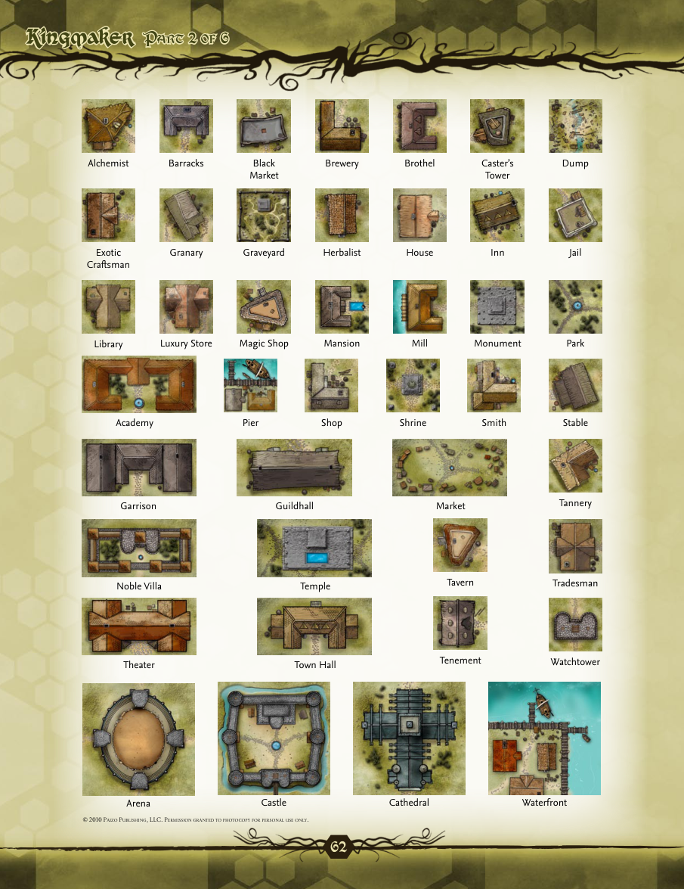


```text
62
P
a r t
 2
o f
 6P
a r t
 2
o f
 6
Alchemist
Exotic
Craftsman
Library
Barracks
Granary
Luxury Store
Black
Market
Graveyard
Magic Shop
Pier
Brewery
Herbalist
Mansion
Shop
Brothel
House
Mill
Shrine
Caster’s
Tower
Inn
Monument
Smith
Dump
Jail
Park
Stable
Tannery
Tavern
Tradesman
Tenement
Watchtower
Academy
Garrison
Guildhall
Noble Villa
Theater
Market
Temple
Town Hall
Arena
Castle
Cathedral
Waterfront
© 2010 P
a i z o
 P
u b l i s h i n g
, llC. P
e r m i s s i o n

g r a n t e d

t o

Ph o t oCoPy

f o r

Pe r s o n a l

u s e

o n l y
.
```


## Printed page 63 (PDF page 65)

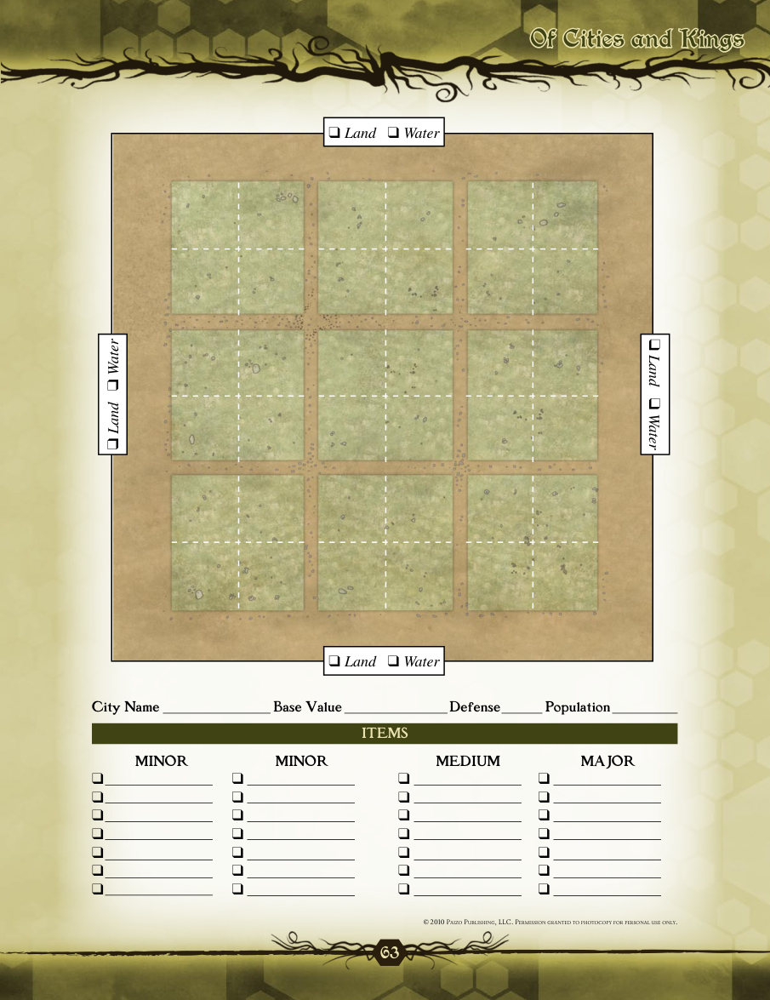


```text
63
Of Cities and KingsOf Cities and Kings
❑ Land   ❑ Water
❑ Land   ❑ Water
❑ Land   ❑ Water
❑ Land   ❑ Water
City Name  Base Value   Defense  Population
ITEMS
MINOR
❑
❑
❑
❑
❑
❑
❑
MINOR
❑
❑
❑
❑
❑
❑
❑
MEDIUM
❑
❑
❑
❑
❑
❑
❑
MAJOR
❑
❑
❑
❑
❑
❑
❑
© 2010 P
a i z o
 P
u b l i s h i n g
, llC. P
e r m i s s i o n

g r a n t e d

t o

Ph o t oCoPy

f o r

Pe r s o n a l

u s e

o n l y
.
```


## Printed page 64 (PDF page 66)

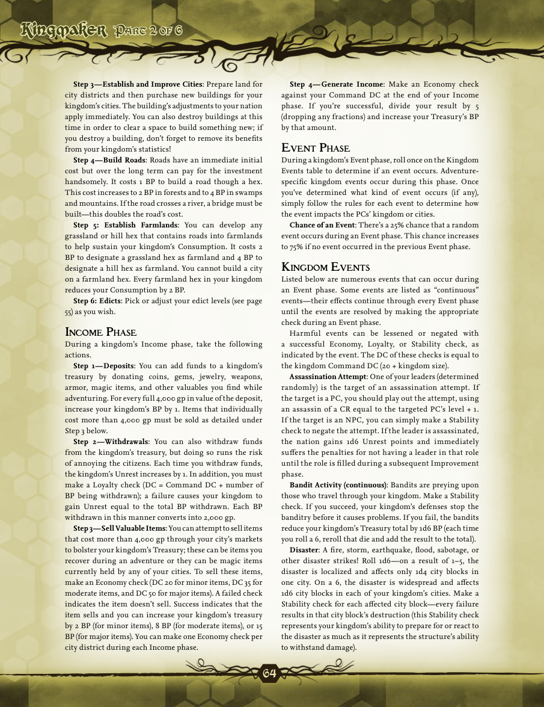


```text
64
P
a r t
 2
o f
 6P
a r t
 2
o f
 6
Step 3—Establish and Improve Cities : Prepare land for
city districts and then purchase new buildings for your
kingdom’s cities. The building’s adjustments to your nation
apply immediately. You can also destroy buildings at this
time in order to clear a space to build something new; if
you destroy a building, don’t forget to remove its benefits
from your kingdom’s statistics!
Step 4—Build Roads : Roads have an immediate initial
cost but over the long term can pay for the investment
handsomely. It costs 1 BP to build a road though a hex.
This cost increases to 2 BP in forests and to 4 BP in swamps
and mountains. If the road crosses a river, a bridge must be
built—this doubles the road’s cost.
Step 5: Establish Farmlands : You can develop any
grassland or hill hex that contains roads into farmlands
to help sustain your kingdom’s Consumption. It costs 2
BP to designate a grassland hex as farmland and 4 BP to
designate a hill hex as farmland. You cannot build a city
on a farmland hex. Every farmland hex in your kingdom
reduces your Consumption by 2 BP.
Step 6: Edicts : Pick or adjust your edict levels (see page
55) as you wish.
i
nCo m e
 p
h a s e
During a kingdom’s Income phase, take the following
actions.
Step 1—Deposits : You can add funds to a kingdom’s
treasury by donating coins, gems, jewelry, weapons,
armor, magic items, and other valuables you find while
adventuring. For every full 4,000 gp in value of the deposit,
increase your kingdom’s BP by 1. Items that individually
cost more than 4,000 gp must be sold as detailed under
Step 3 below.
Step 2—Withdrawals : You can also withdraw funds
from the kingdom’s treasury, but doing so runs the risk
of annoying the citizens. Each time you withdraw funds,
the kingdom’s Unrest increases by 1. In addition, you must
make a Loyalty check (DC = Command DC + number of
BP being withdrawn); a failure causes your kingdom to
gain Unrest equal to the total BP withdrawn. Each BP
withdrawn in this manner converts into 2,000 gp.
Step 3—Sell Valuable Items: You can attempt to sell items
that cost more than 4,000 gp through your city’s markets
to bolster your kingdom’s Treasury; these can be items you
recover during an adventure or they can be magic items
currently held by any of your cities. To sell these items,
make an Economy check (DC 20 for minor items, DC 35 for
moderate items, and DC 50 for major items). A failed check
indicates the item doesn’t sell. Success indicates that the
item sells and you can increase your kingdom’s treasury
by 2 BP (for minor items), 8 BP (for moderate items), or 15
BP (for major items). You can make one Economy check per
city district during each Income phase.
Step 4—Generate Income : Make an Economy check
against your Command DC at the end of your Income
phase. If you’re successful, divide your result by 5
(dropping any fractions) and increase your Treasury’s BP
by that amount.
e
Ve n t
 p
h a s e
During a kingdom’s Event phase, roll once on the Kingdom
Events table to determine if an event occurs. Adventure-
specific kingdom events occur during this phase. Once
you’ve determined what kind of event occurs (if any),
simply follow the rules for each event to determine how
the event impacts the PCs’ kingdom or cities.
Chance of an Event : There’s a 25% chance that a random
event occurs during an Event phase. This chance increases
to 75% if no event occurred in the previous Event phase.
K
i n g d o m
 e
Ve n t s
Listed below are numerous events that can occur during
an Event phase. Some events are listed as “continuous”
events—their effects continue through every Event phase
until the events are resolved by making the appropriate
check during an Event phase.
Harmful events can be lessened or negated with
a successful Economy, Loyalty, or Stability check, as
indicated by the event. The DC of these checks is equal to
the kingdom Command DC (20 + kingdom size).
Assassination Attempt : One of your leaders (determined
randomly) is the target of an assassination attempt. If
the target is a PC, you should play out the attempt, using
an assassin of a CR equal to the targeted PC’s level + 1.
If the target is an NPC, you can simply make a Stability
check to negate the attempt. If the leader is assassinated,
the nation gains 1d6 Unrest points and immediately
suffers the penalties for not having a leader in that role
until the role is filled during a subsequent Improvement
phase.
Bandit Activity (continuous) : Bandits are preying upon
those who travel through your kingdom. Make a Stability
check. If you succeed, your kingdom’s defenses stop the
banditry before it causes problems. If you fail, the bandits
reduce your kingdom’s Treasury total by 1d6 BP (each time
you roll a 6, reroll that die and add the result to the total).
Disaster : A fire, storm, earthquake, flood, sabotage, or
other disaster strikes! Roll 1d6—on a result of 1–5, the
disaster is localized and affects only 1d4 city blocks in
one city. On a 6, the disaster is widespread and affects
1d6 city blocks in each of your kingdom’s cities. Make a
Stability check for each affected city block—every failure
results in that city block’s destruction (this Stability check
represents your kingdom’s ability to prepare for or react to
the disaster as much as it represents the structure’s ability
to withstand damage).
```


## Printed page 65 (PDF page 67)

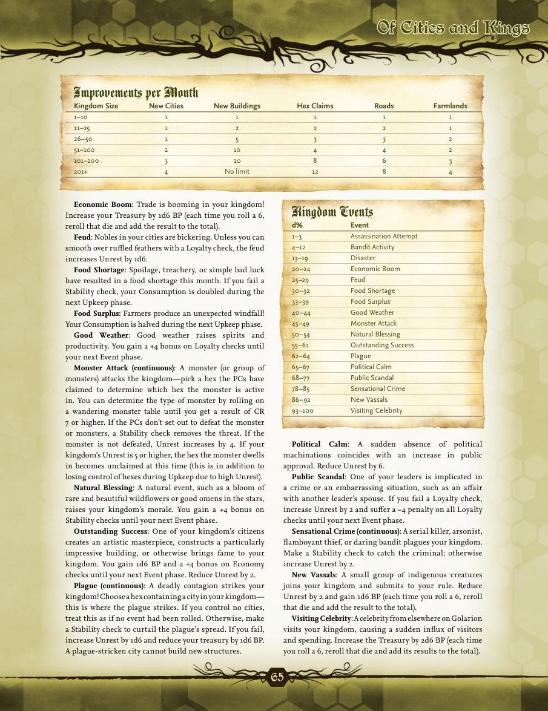


```text
65
Of Cities and KingsOf Cities and Kings
Economic Boom : Trade is booming in your kingdom!
Increase your Treasury by 1d6 BP (each time you roll a 6,
reroll that die and add the result to the total).
Feud: Nobles in your cities are bickering. Unless you can
smooth over ruffled feathers with a Loyalty check, the feud
increases Unrest by 1d6.
Food Shortage : Spoilage, treachery, or simple bad luck
have resulted in a food shortage this month. If you fail a
Stability check, your Consumption is doubled during the
next Upkeep phase.
Food Surplus: Farmers produce an unexpected windfall!
Your Consumption is halved during the next Upkeep phase.
Good Weather : Good weather raises spirits and
productivity. You gain a +4 bonus on Loyalty checks until
your next Event phase.
Monster Attack (continuous) : A monster (or group of
monsters) attacks the kingdom—pick a hex the PCs have
claimed to determine which hex the monster is active
in. You can determine the type of monster by rolling on
a wandering monster table until you get a result of CR
7 or higher. If the PCs don’t set out to defeat the monster
or monsters, a Stability check removes the threat. If the
monster is not defeated, Unrest increases by 4. If your
kingdom’s Unrest is 5 or higher, the hex the monster dwells
in becomes unclaimed at this time (this is in addition to
losing control of hexes during Upkeep due to high Unrest).
Natural Blessing : A natural event, such as a bloom of
rare and beautiful wildflowers or good omens in the stars,
raises your kingdom’s morale. You gain a +4 bonus on
Stability checks until your next Event phase.
Outstanding Success : One of your kingdom’s citizens
creates an artistic masterpiece, constructs a particularly
impressive building, or otherwise brings fame to your
kingdom. You gain 1d6 BP and a +4 bonus on Economy
checks until your next Event phase. Reduce Unrest by 2.
Plague (continuous) : A deadly contagion strikes your
kingdom! Choose a hex containing a city in your kingdom—
this is where the plague strikes. If you control no cities,
treat this as if no event had been rolled. Otherwise, make
a Stability check to curtail the plague’s spread. If you fail,
increase Unrest by 1d6 and reduce your treasury by 1d6 BP.
A plague-stricken city cannot build new structures.
Political Calm : A sudden absence of political
machinations coincides with an increase in public
approval. Reduce Unrest by 6.
Public Scandal : One of your leaders is implicated in
a crime or an embarrassing situation, such as an affair
with another leader’s spouse. If you fail a Loyalty check,
increase Unrest by 2 and suffer a –4 penalty on all Loyalty
checks until your next Event phase.
Sensational Crime (continuous) : A serial killer, arsonist,
flamboyant thief, or daring bandit plagues your kingdom.
Make a Stability check to catch the criminal; otherwise
increase Unrest by 2.
New Vassals : A small group of indigenous creatures
joins your kingdom and submits to your rule. Reduce
Unrest by 2 and gain 1d6 BP (each time you roll a 6, reroll
that die and add the result to the total).
Visiting Celebrity: A celebrity from elsewhere on Golarion
visits your kingdom, causing a sudden influx of visitors
and spending. Increase the Treasury by 2d6 BP (each time
you roll a 6, reroll that die and add its results to the total).
Improvements per Month
Kingdom Size New Cities New Buildings Hex Claims Roads Farmlands
1–10 1 1 1 1 1
11–25 1 2 2 2 1
26–50  1 5 3 3 2
51–100 2 10 4 4 2
101–200 3 20 8 6 3
201+ 4 No limit 12 8 4
Kingdom Events
d% Event
1–3 Assassination Attempt
4–12 Bandit Activity
13–19 Disaster
20–24 Economic Boom
25–29 Feud
30–32  Food Shortage
33–39 Food Surplus
40–44  Good Weather
45–49 Monster Attack
50–54  Natural Blessing
55–61 Outstanding Success
62–64  Plague
65–67  Political Calm
68–77  Public Scandal
78–85  Sensational Crime
86–92  New Vassals
93–100 Visiting Celebrity
```


## City-layout assets

The following preserved page images are the visual references requested for the future city-layout revamp:

- Printed page 62 / PDF page 64: city-building graphics.
- Printed page 63 / PDF page 65: simple city-layout graphic.

These images are page captures from the source PDF and are not modified.
